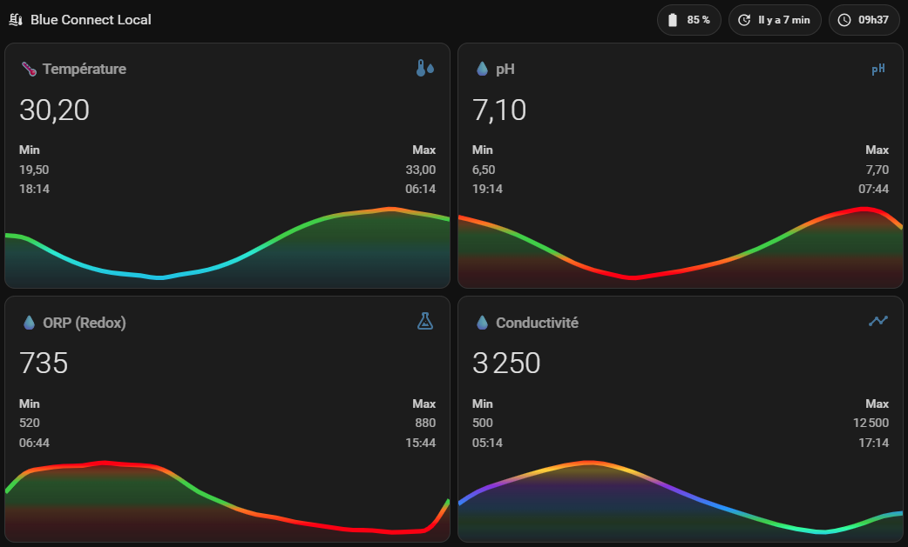
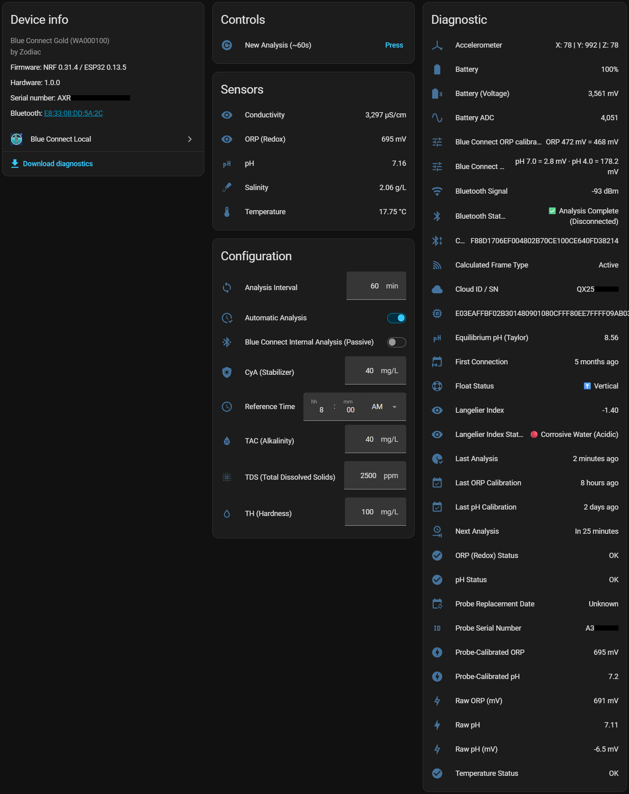

[](https://github.com/Adrien40/ha-blue-connect-local/blob/main/README.fr.md) [](https://github.com/Adrien40/ha-blue-connect-local/blob/main/README.md)

# Blue Connect Local for Home Assistant 🐬
[](https://github.com/hacs/integration)
[](https://github.com/Adrien40/ha-blue-connect-local/releases)
[](https://github.com/Adrien40/ha-blue-connect-local/blob/main/LICENSE)
[](https://github.com/Adrien40/ha-blue-connect-local/actions/workflows/tests.yaml)
[](https://github.com/Adrien40/ha-blue-connect-local/actions/workflows/hacs.yaml)
[](https://github.com/Adrien40/ha-blue-connect-local/actions/workflows/hassfest.yaml)
[](https://github.com/Adrien40/ha-blue-connect-local/actions/workflows/ruff.yaml)
[](https://github.com/Adrien40/ha-blue-connect-local/actions/workflows/mypy.yaml)
[](https://github.com/Adrien40/ha-blue-connect-local/blob/main/custom_components/blue_connect_local/quality_scale.yaml)
[](#-high-resolution-ph-blue-connect-zodiac-active-mode)

If this project is useful to you, you can support its development 🙏

<a href="https://www.buymeacoffee.com/adrien40"></a>

---

## ⚡ At a Glance
- 🔬 **High-resolution pH (2 decimals), exclusive**: not available in the official app, which shows 0.1 (ZODIAC, Active Mode)
- 🎛️ **Calibrate your probe from Home Assistant**: pH and ORP, sent straight into the Blue Connect (Active Mode)
- 🔌 100% local operation via Bluetooth (BLE)
- 🏠 Compatible with Home Assistant (no cloud)
- 🏷️ Automatic Model Detection (Gold / Silver)
- 🔵 Blueriiot-profile probes (Blue Connect Plus) supported, with automatic discovery (see *Compatibility*)
- 🌡️ Measurements: Temperature, pH, ORP (Redox), Salinity, Conductivity, Battery
- 🎯 Manual Analysis: Force a new water analysis on demand, remotely
- ⚖️ Floating Status
- 🔋 Optimized to preserve battery life
- ⚙️ Installation via the Marketplace or HACS in 2 minutes

---

## 📸 Examples in Home Assistant

### 📊 Visualization

<p align="center">
  
</p>

<p align="center">
  <em>📊 Overview of pool data in Home Assistant</em>
  <br>
  👉 <a href="docs/dashboard_example.md"><strong>Get the dashboard YAML</strong></a>
</p>

---

### 🔍 Technical Details

<p align="center">
  
</p>

<p align="center">
  <em>🔍 Entities exposed by the integration & ⚙️ Advanced configuration options</em>
</p>

---

A **100% local integration for Home Assistant** that turns your Blue Connect analyzer into a Bluetooth Low Energy (BLE) sensor, letting you control and monitor your pool with zero dependency on the Cloud. 🛡️

> ⚠️ **Warning**: This integration queries the Blue Connect directly over Bluetooth.

### 💡 Why This Integration?
This integration frees your Blue Connect from the Cloud by directly leveraging its BLE protocol, for uncompromising home automation:

* **🔒 100% local:** Works without internet. Your data goes straight from the pool to Home Assistant.
* **⏱️ No API limits:** Passive listening to regular data frames, plus the ability to force a measurement on demand, with no restrictions.
* **🛡️ Longevity:** Total independence from official servers, so your hardware keeps working for the long haul.

**Blue Connect Local** is the result of in-depth **reverse engineering** work to turn your analyzer into a true local, industrial-grade sensor capable of communicating directly with your Home Assistant instance.
Blue Connect Local replaces the cloud with a **local control** solution, while offering a reliable **pool monitoring** system built on a **BLE sensor**.

---

### ✅ Compatibility / Requirements
* 🏷️ **Supported models**: ZODIAC Blue Connect (Gold / Silver) with **automatic detection and adaptation** of sensors (Conductivity and Salinity).
* 🏅 **Tested on**: Validated on the **ZODIAC Blue Connect Gold and Silver**.
* 🔵 **Blueriiot-profile probes (Blue Connect Plus)**: supported since **1.3.0**. The integration detects the Blueriiot GATT profile when it connects and decodes temperature, pH, ORP, conductivity, salinity and battery. **Active Mode only** (Access Code required). Confirmed by a contributor on a **Blue Connect Plus (firmware 2.3.0)**. These probes are auto-discovered when their Bluetooth name starts with **B20** (seen on a Blue Connect Plus); otherwise add them manually with their MAC address and access code. On a Blue Connect Plus, the access code is the key shown in the Blueriiot app (*Access key*, 8 or 9 characters).
* 🔑 **Access Code (Optional)**: Your device's access code: **9 characters** on a Blue Connect (ZODIAC), **8 or 9 characters** on a Blue Connect Plus (Blueriiot, shown in its app). It isn't required for passive listening, but it is **essential** for on-demand analyses.
* 🛠️ **Required hardware**: Internal Bluetooth adapter, USB Bluetooth dongle, or an **ESPHome Bluetooth Proxy** (strongly recommended, [easy installation here](https://esphome.github.io/bluetooth-proxies/)).
* 📶 **Signal quality**: A stable RSSI signal (ideally **above -75 dBm**) is essential to guarantee a reliable connection to the Blue Connect. Testing shows that a signal below -90 dBm causes frequent read failures.
* ⏱️ **Real-time monitoring**: A `sensor.*_signal_bluetooth` entity uses Home Assistant's passive listening so you can watch signal strength live — all without draining the Blue Connect's battery!

> 📡 **Using an ESPHome Bluetooth Proxy?** The ZODIAC diagnostic sensors need two extra settings on the proxy: see [ESPHome Bluetooth Proxy: settings for the diagnostic sensors](#-esphome-bluetooth-proxy-settings-for-the-diagnostic-sensors).

---

### ✨ Highlights
* 🏠 **100% Local (BLE)**: No Cloud dependency, no subscription, no latency.
* 🏷️ **Smart Model Detection**: Automatic identification of your device variant (Gold or Silver) in both active and passive modes. Conductivity and Salinity sensors are automatically enabled or disabled according to your hardware probe.
* 🌡️ **Raw sensor readings**: Temperature, pH, ORP (Redox), Salinity, Conductivity, Battery (%).
* 🚀 **Real-time analysis**: Trigger a manual measurement whenever you want.
* 🧪 **Advanced Chemical Intelligence**:
  * Calculates the **Langelier Saturation Index** (LSI) to tell you whether your water is balanced, scale-forming, or corrosive.
* 🟤 **Multi-treatment support**: Works with **Bromine** (automatically disables the CYA entity, which isn't relevant for that treatment) and with stabilizer-free pools (CYA = 0). The treatment type and the CYA level are kept for future use: **no calculated value depends on them at the moment**.
* ⚙️ **100% UI Configuration**: Automatic Bluetooth discovery, probe calibration, and alert threshold settings, all directly from the Home Assistant interface (no YAML required).
* 🔬 **High-resolution pH**, not available in the official app (ZODIAC, Active Mode): pH to 2 decimals instead of the 0.1 the app shows, using the pH calibration stored in the probe (see *High-resolution pH* below).
* 🎛️ **Calibrate the probe from Home Assistant**: read the mV in your buffer solutions (pH) or in a reference solution (ORP), enter them in the options and send the calibration into the Blue Connect, like the official app's wizard (Active Mode; see *Integration mV calibration* and *ORP calibration* below).
* 🔄 **Sync Modes**: Passive Mode (silent, battery-saving listening) and Active Mode (on-demand Bluetooth analyses via the access code).
* ⏱️ **Scheduled Analyses on Fixed Time Slots** (Active Mode): set an **Analysis Interval** and a **Reference Time**; analyses run at the same times every day instead of on a rolling interval (see *Scheduled Analyses* below).
* 🌍 **Multi-language**: Developed in French 🇫🇷 and available in EN, ES, DE, IT, NL, PL, PT, PT-BR, SV, RU, ZH-HANS, ZH-HANT, CS, HU, EL, HR, DA, NB (AI-translated).

---

### 🚀 Installation

#### Via the Marketplace (Home Assistant 2026.11 and later)
Since 2026.11, HACS is built into Home Assistant as the **Marketplace**. This repository isn't (yet) in its catalog, so add it from its link. Click this button to open the Marketplace, then continue at step 2:

[](https://my.home-assistant.io/redirect/marketplace_repositories/)

Or open it by hand (step 1):

1. Go to **Settings** > **Marketplace** (administrators only). The first time, read the notice and accept it.
2. Click **Add from link** in the top-right corner.
3. Enter `https://github.com/Adrien40/ha-blue-connect-local` and click **Add**.
4. Search for **Blue Connect Local**, open it, click **Install**, then **Install** again to confirm.
5. The setup page opens by itself. If it doesn't, or if Home Assistant asks for a restart (**Settings** > **System** > **Repairs**), restart, then go to **Settings** > **Devices & Services** > **Add Integration** and search for "Blue Connect Local".

Updates then show up under **Settings** > **Updates**. Restart Home Assistant after updating the integration.

<details>
<summary><h4>Via HACS (Home Assistant up to 2026.10)</h4></summary>

This repository isn't (yet) in the official default list, so you'll need to add it as a custom repository.

1. Open **HACS** in your Home Assistant.
2. Click the 3 dots in the top-right corner and select **Custom repositories**.
3. Under **Repository**, paste the URL: `https://github.com/Adrien40/ha-blue-connect-local`
4. Under **Type**, choose **Integration**, then click **Add**.
5. Once added, a window will pop up: click **Download** (select the latest version).
6. **Fully restart Home Assistant**.
7. Go to **Settings** > **Devices & Services** > **Add Integration** and search for "Blue Connect Local".

HACS can no longer be installed on 2026.11 and later. If you already use it, nothing to do: Home Assistant migrates it to the Marketplace when it starts after the update, and the integration stays installed and keeps receiving updates.

</details>

<details>
<summary><h4>Manual</h4></summary>

Copy the `custom_components/blue_connect_local` folder into the `custom_components` folder of your Home Assistant configuration, then restart.

</details>

### 🗑️ Removal
1. Go to **Settings** > **Devices & Services**, find your Blue Connect device, click the 3 dots and select **Delete**. This removes all entities and stops the Bluetooth polling/listening.
2. If installed via the Marketplace: open **Settings** > **Marketplace**, open **Blue Connect Local**, click the 3 dots and select **Uninstall** (delete the device first, as in step 1: an integration that is still set up cannot be uninstalled). If installed via HACS (before 2026.11): open **HACS**, find **Blue Connect Local**, click the 3 dots and select **Remove**.
3. If installed manually: delete the `custom_components/blue_connect_local` folder, then restart Home Assistant.

Removing the integration also deletes its locally stored history (last known values, calibration reference points, access code). If you only want to pause measurements without losing this data, use the **Automatic Analysis** switch instead of deleting the integration.

---

### 📊 Available Sensors and Controls
| Entity | Unit / Type | Description |
| :--- | :--- | :--- |
| 💧 **pH** | pH | Water pH: 2 decimals after an active analysis (**high resolution**), 0.1 from a passive frame. See *High-resolution pH* below. |
| 🔬 **Raw pH** | pH (diagnostic) | Electrode potential read as a pH with no calibration: pH 7 at 0 mV, fixed slope of 59.16 mV per pH unit (Active Mode, access code). Disabled by default. |
| 🔬 **Probe-Calibrated pH** | pH (diagnostic) | The calculated frame's pH, with the probe's own calibration (0.1 resolution). Disabled by default. |
| 🔬 **Raw pH (mV)** | mV (diagnostic) | Electrode potential before any calibration (ZODIAC, Active Mode). Disabled by default. |
| 🔬 **Blue Connect pH calibration** | Text (diagnostic) | The two calibration points stored in the probe, as `pH 7.0 = 2.8 mV · pH 4.0 = 178.2 mV`, with `ph_1`, `ph_2`, `mv_1`, `mv_2` as attributes. Disabled by default (ZODIAC, Active Mode, access code). The registers are read on each analysis anyway for the high-resolution pH; with your own mV calibration, they are only read while this sensor is enabled. |
| ⚡ **ORP (Redox)** | mV | Oxidation-reduction potential: the raw electrode potential plus the calibration in use (yours if filled in, otherwise the probe's). The `calibration_source` attribute tells which. |
| 🔬 **Raw ORP (mV)** | mV (diagnostic) | Electrode potential before any calibration (ZODIAC, Active Mode). Disabled by default. |
| 🔬 **Probe-Calibrated ORP** | mV (diagnostic) | The calculated frame's ORP, with the probe's own calibration. Disabled by default. |
| 🔬 **Blue Connect ORP calibration** | Text (diagnostic) | The calibration stored in the probe: the reference solution's mV, then the mV the electrode read in it, as `ORP 468 mV = 472 mV`, with `reference`, `measured`, `correction` (reference minus measured) and `status_code` as attributes. Disabled by default (ZODIAC, access code). |
| 🌡️ **Temperature** | °C | Precise water temperature. |
| 🧂 **Salinity** | g/L | Water salinity (automatically enabled on Blue Connect Gold). |
| 🧪 **Conductivity** | µS/cm | Electrical conductivity (automatically enabled on Blue Connect Gold). |
| ⚖️ **Langelier Saturation Index** | LSI | Water balance indicator (Corrosive, Balanced, or Scale-forming). |
| 🎯 **Equilibrium pH** | pH | Ideal pH target, calculated per the Taylor Balance. |
| 🔋 **Battery** | % and mV | Charge level (%) and raw battery voltage. |
| 📶 **RSSI Signal** | dBm | Real-time received Bluetooth signal strength. |
| 🔵 **Bluetooth Status** | Status | Detailed connection state (Connected, Standby, Error...). |
| ⏱️ **Next Analysis** | Timestamp | Estimated time of the next data reading. |
| 🚀 **New Analysis** | Button | **Trigger an instant analysis (~60s).** |
| ⏸️ **Automatic Analysis** | Switch | Turn automatic readings on/off (Pause Mode). |
| 🔄 **Analysis Interval** | Setting (min) | Time between two scheduled analyses (5 – 1440), Active Mode. |
| 🕒 **Reference Time** | Setting (time) | Time the analysis slots are anchored on (default 08:00). |
| 📡 **Blue Connect Internal Analysis (Passive)** | Switch | Use the readings the probe broadcasts on its own. |
| 💧 **TAC / TH / TDS / CyA** | Settings (mg/L, ppm) | Water parameters used for the Langelier index and the equilibrium pH (CyA is recorded for future use). |

> 🛠️ **Device Info & Diagnostics**: **Serial Number**, **Model Number (SKU)**, and **MAC Address** are natively integrated into the Home Assistant device header. The integration also exposes advanced diagnostic sensors (raw pH, raw ORP in mV, full raw hex frame, floating status, and binary alerts). The most technical ones (calculated and electrical frames, calculated frame type, Battery ADC, Cloud ID / SN, accelerometer and the raw pH and ORP sensors) are disabled by default on new installations: enable them from the device page when you need them.

> 🔧 **ZODIAC diagnostic sensors (disabled by default)**: **Probe Serial Number**, **First Connection**, **Probe Replacement Date**, **Last pH Calibration** and **Last ORP Calibration**. They are read from the probe after an active analysis and kept across restarts; the hardware and firmware versions also appear in the device card. They are *unavailable* on Blueriiot probes. Behind an ESPHome Bluetooth proxy they may stay *unknown* until the proxy is set up as described [below](#-esphome-bluetooth-proxy-settings-for-the-diagnostic-sensors).

> ℹ️ **On Blue Connect Silver** (no conductivity probe): the Conductivity and Salinity entities are automatically disabled. If you updated an existing installation where Conductivity was already present, the integration now detects the Silver model and disables these entities on its own — no manual action needed.

---

### 🧪 Chemical Expertise: Professional-Grade Analysis

👉 No need to understand these calculations — Home Assistant automates everything.

<details>
<summary>🔬 See the scientific details</summary>

#### Water Balance: Langelier Saturation Index & Taylor Balance ⚖️
The Langelier Saturation Index (LSI) is the essential companion to the **Taylor Balance**. It tells you whether your water is:
* **Corrosive (LSI < -0.3)**: The water attacks your seals, liner, and metal parts.
* **Balanced (LSI between -0.3 and +0.3)**: Perfect water.
* **Scale-forming (LSI > +0.3)**: Risk of limescale buildup.

Enter your TAC (Total Alkalinity), TH (Total Hardness), and TDS in the options, and Home Assistant will calculate your balance live, based on the temperature read from the Blue Connect!

</details>

---

### 🎯 A Note on Measurement Accuracy
Values shown in Home Assistant may differ slightly from those in the official Blue Connect app.

Blue Connect Local supports "high-precision" calibration. Unlike the mobile app, which uses fixed values, our integration lets you enter the exact value of your buffer solution (pH 7.02, 4.01, etc.), adjusted for temperature during calibration. This scientific rigor is what can create a slight offset — a sign that the reading is actually closer to your pool's true conditions. 🔬 On a ZODIAC probe in Active Mode, the *high-resolution pH* also goes beyond the 0.1 shown by the official app (see *High-resolution pH* below), which can add to the difference.

---

## 🚀 Configuration
> ⚠️ Requires **Home Assistant 2026.3.0 or newer** (the first release shipped with Python 3.14). Tested on 2026.3.0 and 2026.10.

1. Go to **Settings** > **Devices & Services**.
2. The integration should automatically detect your Blue Connect if your Bluetooth dongle/antenna is in range. Otherwise, click **Add Integration** and search for **Blue Connect Local**.
3. Follow the on-screen instructions to set your treatment type (Chlorine, Bromine) and your probe calibration/offset.

### ⚙️ Options, Calibration & Alerts
Once the device has been added, you can click **Configure** ⚙️ to:
* Adjust the values of your calibration solutions (pH 4, pH 7, ORP).
* Update your water parameters (TAC, TH, TDS, Stabilizer) directly via the exposed controls.
* Set the **Analysis Interval** and the **Reference Time** (⏱️ *Synchronization* section), see *Scheduled Analyses* below.
* Set your own **custom alert thresholds** (pH Min/Max, ORP Min/Max, etc.) to drive your own automations.

> Find the step-by-step procedure (calibration in mV or by pH value, ORP, temperature compensation, and Alert Thresholds) in the **[Calibration Guide](docs/calibration_help.md)**. Release notes are in the **[Changelog](CHANGELOG.md)**.

### ⏱️ Scheduled Analyses (Active Mode)
When an **Access Code** is set (Active Mode), automatic analyses are not run "every N minutes since the last one": they are aligned on **fixed time slots**, so you get readings at predictable times, whatever happened before (restart, manual analysis, error).

| Setting | Default | Range | Role |
| :--- | :--- | :--- | :--- |
| 🔄 **Analysis Interval** | 60 min | 5 – 1440 min | Time between two scheduled analyses. |
| 🕒 **Reference Time** | 08:00 | HH:MM | Time the slots are anchored on. |

* **Example**: with an interval of **120 min** and a reference time of **08:00**, analyses run at 08:00, 10:00, 12:00, 14:00… (and 06:00, 04:00… before it).
* **Where to change them**: **Configure** ⚙️ > **⏱️ Synchronization** section, or directly from the **Analysis Interval** and **Reference Time** entities of the device (configuration category), for instance on a dashboard.
* **Changes apply immediately**: the next analysis is re-planned as soon as you change either setting.
* **Tip**: pick an interval that divides 24 h evenly (5, 10, 15, 20, 30, 60, 120, 180, 240, 360, 480, 720 or 1440 min). Otherwise the slots shift from one day to the next, because they are re-anchored on the Reference Time every day.
* A slot less than 10 seconds away is skipped in favour of the following one.
* **New Analysis** (requires an access code) runs immediately and does not change the schedule.
* **Automatic Analysis** switched off: scheduled analyses are skipped. Switching it back on does **not** start an analysis by itself; the next one runs at the next slot (or press **New Analysis**).
* **Without an access code (Passive Mode)** there is no schedule: Home Assistant uses the readings the probe broadcasts on its own, about one per hour.

### 🔬 High-resolution pH (Blue Connect ZODIAC, Active Mode)
> ✨ **Not available in the official app**, which shows the pH to 0.1. Blue Connect Local goes further by reading the electrode's potential itself.

The pH of the calculated frame is rounded to 0.1 by the probe. With an access code, each analysis also reads the electrode potential (*electrical frame*) and converts it with a **two-point calibration**: by default the one **stored in the probe** (the same registers the official app writes to), read once and cached until the probe's calibration date changes. It reproduces the probe's own formula (it matched its rounded pH on hundreds of real frames), minus the rounding: you get the pH to **2 decimals**. This is a finer *resolution*: the *accuracy* still depends on your electrode and on a good calibration.

* The **pH** sensor shows 2 decimals while the last frame comes from an active analysis and the electrical frame could be read (`source: high_resolution`, `resolution: 0.01`, `calibration_source: probe` or `integration`). Otherwise (passive frame, electrical frame unreadable) it falls back to the pH of the calculated frame (0.1, `source: standard`), calibrated with the integration's standard pH calibration as before. That standard calibration is **not** applied to the high-resolution pH.
* **Recommended**: with an access code, turn off **Blue Connect Internal Analysis (Passive)**, otherwise each passive frame replaces the 2-decimal pH with the 0.1 one. Home Assistant suggests it in **Settings > Repairs**, and it is off by default on new installations with an access code. The probe keeps measuring; Home Assistant simply ignores its passive frames.
* Not available on the Blue Connect Plus (Blueriiot).

#### Integration mV calibration (optional, takes priority)
*Options > Probes Calibration* (empty by default). With the probe dipped in each buffer solution (pH 4 / pH 7), read the **Raw pH (mV)** sensor and enter both values with the target pH of each solution: both, or none. Once filled in, this calibration replaces the probe's for the high-resolution pH; clear both to go back. Without an access code, calibration by pH value stays available in the collapsed section *pH calibration by value (without access code)*. Step by step: **[Calibration Guide](docs/calibration_help.md)**.

The **Send the calibrations to the Blue Connect** tick box (needs an access code) writes the calibration(s) filled in the form into the probe's registers at the next analysis and updates their calibration date, like the official app's wizard. It sends the pH (both mV values filled in) and/or the ORP (both values filled in), **only what changed since the last successful sending**: ticking it to send the ORP never rewrites the pH, nor refreshes its date. It is never stored. ⚠️ It also recalibrates the probe's *standard* pH and ORP, what the official app shows and what its onboard alert thresholds are compared against: send only values you trust. To check what the probe holds, turn on the **Blue Connect pH calibration** or **Blue Connect ORP calibration** diagnostic sensors (disabled by default), e.g. `pH 7.0 = 2.8 mV · pH 4.0 = 178.2 mV`.

### ⚡ ORP calibration (Blue Connect ZODIAC, Active Mode)
The ORP of the calculated frame already carries the probe's own correction (*reference − measured*, two registers written by the official app's calibration). With an access code, each analysis also reads the **raw electrode potential**: the **ORP** sensor is that potential plus the correction of the calibration in use, so a calibration is never applied twice.

* **By default** the probe's calibration is used (the same value as the calculated frame). *Options > Probes Calibration* has two ORP fields, **empty by default**: the mV read by **Raw ORP (mV)** with the probe dipped in a reference solution, and that solution's mV. Fill in both, or none. Once filled in, they take priority over the probe's; clear both to go back. They apply to the raw potential, so they need an access code.
* A frame the probe broadcasts on its own (Passive Mode) has no electrical frame: the raw potential is recovered by removing the probe's correction, read during the last active analysis, so the ORP does not change with the way a frame arrived.
* **Abnormal calibration**: if the gap between the reference and the measured value exceeds **100 mV**, or if the pH electrode slope leaves **50-63 mV/pH** or its offset at pH 7 exceeds **±60 mV**, a **warning** appears in *Settings > Repairs* (a wrong or old solution, a dirty electrode, or a probe at the end of its life). Nothing is blocked: you stay free to keep and even send any calibration. These limits are generic rules of thumb for electrodes, not a Blue Connect specification.

### 📡 ESPHome Bluetooth Proxy: settings for the diagnostic sensors
Temperature, pH, ORP, conductivity and battery work with any proxy. The **ZODIAC diagnostic sensors** (*Probe Serial Number*, *First Connection*, *Probe Replacement Date*, *Last pH Calibration*, *Last ORP Calibration*) and the **hardware / firmware versions** of the device card can stay **unknown** behind an ESPHome proxy, because of a default limit on the proxy: ESP-IDF keeps at most **40 characteristics** when it discovers a device (`CONFIG_BT_GATTC_MAX_CACHE_CHAR`, default 40). The Blue Connect has more, so its GATT table is cut and `70ea0023` and the following characteristics are never seen. A direct Bluetooth adapter is not affected.

**Fix, in the ESPHome YAML of your proxy** (ESP-IDF framework required):

```yaml
esp32:
  board: esp32dev
  framework:
    type: esp-idf
    sdkconfig_options:
      CONFIG_BT_GATTC_MAX_CACHE_CHAR: "200"

bluetooth_proxy:
  active: true
  cache_services: false
```

* `CONFIG_BT_GATTC_MAX_CACHE_CHAR: "200"` lets the proxy return the whole table.
* `cache_services: false` turns off the proxy's service cache stored in flash: it may still hold the old, truncated table and give it back even with the higher limit. Services are then discovered at each connection, which can make connections slightly slower.
* If your proxy YAML is split (a shared template included with `packages:` plus a small file per device), you can put these keys in the small file: they are merged with the template. With several proxies, apply them to each one (Home Assistant uses the proxy that receives the probe best).

**Apply it:**
1. In the ESPHome dashboard, click **Validate**, then **Install > Wirelessly** (the first build after an `sdkconfig` change is long).
2. When the proxy is back online, **restart Home Assistant**.
3. Run **New Analysis**. The sensors are disabled by default: enable them first in the device's entities, they are filled after the analysis.

**Check it:** enable debug logging (`custom_components.blue_connect_local: debug`) and look for the line `GATT table (N characteristics)` during an analysis. With the fix it lists `70ea0023-…` up to `70ea0030-…`; without it, the list stops at `70ea0022-…`.

---

### 🐛 Troubleshooting

<details>
<summary>⚠️ See common issues</summary>
  
* **The diagnostic sensors (probe serial number, dates) stay `unknown`**: they only exist on ZODIAC probes, need an access code and an active analysis, and must be enabled first. Behind an ESPHome proxy, apply the [proxy settings](#-esphome-bluetooth-proxy-settings-for-the-diagnostic-sensors).
* **Frequent Bluetooth errors**: The integration automatically handles connection retries. If the sensor shows `Signal Lost`, the Blue Connect is out of range. Move your antenna closer, or [install an ESPHome Bluetooth Proxy](https://esphome.github.io/bluetooth-proxies/) as close to the pool as possible (all you need is an ESP32 (~€10) and a USB charger).
* **Invalid access code**: The integration checks your access code as soon as it connects, so if it's wrong you'll see `Invalid access code` on the Bluetooth Status sensor within seconds — no need to wait for the full analysis timeout. Home Assistant will also prompt you to re-enter it via a **Re-authenticate** notification; you can also fix it manually in **Configure ⚙️**, which triggers a new analysis automatically once you save.

</details>

### 🎯 Use Cases
* **Pool safety automation**: trigger a notification or turn off the filtration pump if pH or ORP drifts outside your safe range, using the `pH Status` / `ORP (Redox) Status` binary sensors.
* **Freeze protection**: combine the `Temperature Status` binary sensor with a heater or cover automation when winter temperatures approach freezing.
* **Chemical dosing reminders**: use the Langelier Index Status sensor to get notified when your water becomes corrosive or scale-forming, before it damages your equipment.
* **Passive-only monitoring**: without an access code, Blue Connect Local still gives you hourly readings from the probe's own broadcasts — useful if you don't want or need on-demand analyses.

### 🤖 Automation Examples

<details>
<summary>📋 Notify when pH goes out of range</summary>

```yaml
automation:
  - alias: "Pool pH out of range"
    trigger:
      - platform: state
        entity_id: binary_sensor.blue_connect_ph_status
        to: "on"
    action:
      - action: notify.mobile_app_your_phone
        data:
          title: "⚠️ Pool pH alert"
          message: "pH is currently {{ states('sensor.blue_connect_ph') }}, outside the configured range."
```
</details>

<details>
<summary>📋 Alert if the probe has not reported in a while</summary>

```yaml
automation:
  - alias: "Blue Connect unreachable too long"
    trigger:
      - platform: event
        event_type: repairs_issue_registry_updated
        event_data:
          action: create
          domain: blue_connect_local
    action:
      - action: notify.mobile_app_your_phone
        data:
          title: "🔌 Blue Connect unreachable"
          message: "The Blue Connect probe hasn't responded in a while. Check its battery and Bluetooth range."
```
</details>

### ⚠️ Known Limitations
* **Bluetooth range**: like any BLE device, Blue Connect needs to stay within range of a Bluetooth adapter or [ESPHome proxy](https://esphome.github.io/bluetooth-proxies/). Thick pool covers, distance, and metal structures can weaken the signal.
* **No push notifications from the probe**: on-demand analyses aside, data is refreshed on the scheduled time slots (Active Mode) or when the probe broadcasts its own reading, about once an hour (Passive Mode), not a live continuous stream.
* **ORP is not a chlorine measurement**: it reflects the oxidising strength of the water (pH, temperature, stabilizer, probe ageing), not a concentration. Use the ORP value with your own thresholds and a manual test kit for actual chlorine levels.
* **One probe per config entry**: if you own multiple Blue Connect units, add each one as a separate integration entry.
* **Blueriiot hardware** (Blue Connect Plus): Active Mode only, with no serial number, model (SKU) or floating status, since those come from ZODIAC-specific characteristics. A wrong access code is only reported after the analysis timeout. Not tested by me on real hardware.

---

### 🤝 Contributing & Support
For any bugs or feature requests, please open an [Issue](https://github.com/Adrien40/ha-blue-connect-local/issues) on this repository.

### ⚠️ Disclaimer
This integration is an independent project. It has no affiliation whatsoever with the FLUIDRA/ZODIAC company. Use of this software is at your own risk.

### ⚖️ License
Project licensed under **GPLv3**. Independent of the FLUIDRA company. Use at your own risk.

---

**Built with ❤️ by @Adrien40**

<a href="https://www.buymeacoffee.com/adrien40"></a>

<!-- Keywords: Home Assistant custom integration, BLE sensor, pool monitoring, local control -->
