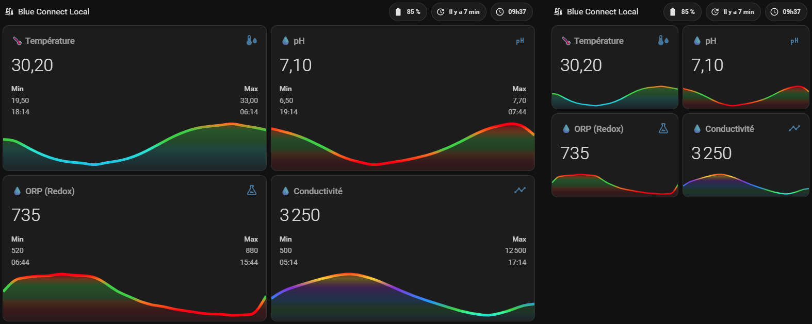

[](dashboard_example.md) [](#)
[← Retour au README](../README.fr.md)

# 📊 Blue Connect Local - Exemple de Dashboard

Cette page donne le YAML du dashboard présenté dans le README, pour le copier dans votre propre Home Assistant. Il se compose de **deux cartes** placées l'une après l'autre dans une vue *Sections*. 💡

<p align="center">
  
  <br>
  <em>À gauche : avec min / max (étape 5), à droite : sans (étape 6).</em>
</p>

---

## 1. 📦 Prérequis

Les cartes s'appuient sur trois cartes personnalisées, toutes disponibles via **HACS** (Interface) :

| Carte | Utilisation |
|---|---|
| [`mini-graph-card`](https://github.com/kalkih/mini-graph-card) | Les graphiques 24 h avec seuils de couleur |
| [`mushroom`](https://github.com/piitaya/lovelace-mushroom) | Les badges (batterie, dernière mise à jour, heure) |
| [`card-mod`](https://github.com/thomasloven/lovelace-card-mod) | Garde les badges sur une seule ligne |

> 💡 La mise en page est pensée pour une vue **Sections**. Dans un autre type de vue (Masonry, Panneau), les cartes fonctionnent aussi : supprimez simplement le bloc `grid_options` final de la carte des graphiques.

---

## 2. ✏️ Adapter les noms d'entités

Le YAML ci-dessous utilise les identifiants d'entités d'une **Blue Connect Gold** (`sensor.blue_connect_gold_*`). **Vos identifiants dépendent du nom de votre sonde dans Home Assistant** : remplacez-les par les vôtres :

| Dans le YAML | Entité |
|---|---|
| `sensor.blue_connect_gold_temperature` | Température |
| `sensor.blue_connect_gold_ph` | pH |
| `sensor.blue_connect_gold_orp_redox` | ORP (Redox) |
| `sensor.blue_connect_gold_conductivite` | Conductivité (`_conductivity` avec une interface en anglais) |
| `sensor.blue_connect_gold_batterie` | Batterie (`_battery` avec une interface en anglais) |

> 💡 Les identifiants exacts se trouvent dans **Paramètres** > **Appareils et services** > **Blue Connect Local** > *entités*. Le plus simple est de faire un *Rechercher / Remplacer* de `blue_connect_gold` par votre propre préfixe dans l'éditeur.

---

## 3. 🚀 Ajouter les cartes

Dans votre vue **Sections**, cliquez sur ⋮ > **Modifier le tableau de bord**, puis, dans la section de votre choix :

1. Cliquez sur **+ Ajouter une carte**, descendez et choisissez **Manuel**, collez le YAML de l'étape 4 (titre et badges), puis **Enregistrez**.
2. Recommencez avec le YAML de l'étape 5 (graphiques).

---

## 4. 🏷️ Titre et badges

Titre avec trois badges : le **niveau de batterie**, le **temps écoulé depuis la dernière analyse** et l'**heure de la dernière analyse**.

```yaml
type: heading
icon: mdi:pool-thermometer
heading: Blue Connect Local
heading_style: title
badges:
  - type: custom:mushroom-template-badge
    icon: mdi:battery
    content: >-
      {{ "{:,.0f}".format(states('sensor.blue_connect_gold_batterie') | float) |
      replace(',', ' ') }} %
    card_mod:
      style: |
        :host {
          white-space: nowrap;
        }
  - type: custom:mushroom-template-badge
    icon: mdi:update
    content: >-
       
        
        
        {% set minutes = ((diff % 3600) // 60) %}
        
          Il y a {{ heures }} h
        
          Il y a {{ minutes }} min
        
      
        Inconnu
      
    card_mod:
      style: |
        :host {
          white-space: nowrap;
        }
  - type: custom:mushroom-template-badge
    icon: mdi:clock-outline
    content: >-
       
        {{ as_timestamp(last_up) | timestamp_custom('%Hh%M') }}
      
        --h--
      
    card_mod:
      style: |
        :host {
          white-space: nowrap;
        }
```

---

## 5. 📈 Graphiques

Quatre graphiques sur 24 h (température, pH, ORP, conductivité) avec seuils de couleur, sur toute la largeur de la section. Les valeurs **min / max** sont affichées (`extrema: true`).

```yaml
square: false
type: grid
columns: 2
cards:
  - type: custom:mini-graph-card
    cache: false
    decimals: 2
    entities:
      - entity: sensor.blue_connect_gold_temperature
        name: 🌡️ Température
    color_thresholds:
      - value: 20
        color: '#00AEEF'
      - value: 25
        color: '#00E4D0'
      - value: 27
        color: '#32CD32'
      - value: 29.5
        color: '#32CD32'
      - value: 31
        color: '#FF8000'
      - value: 32.5
        color: '#FF0000'
    color_thresholds_transition: smooth
    smoothing: true
    points_per_hour: 1
    hours_to_show: 24
    line_width: 5
    show:
      fill: fade
      graph: line
      extrema: true
      legend: false
    locale: fr
    hour24: true
    icon: mdi:thermometer-water
  - type: custom:mini-graph-card
    cache: false
    decimals: 2
    entities:
      - entity: sensor.blue_connect_gold_ph
        name: 💧 pH
    color_thresholds:
      - value: 6.6
        color: '#FF0000'
      - value: 6.9
        color: '#FF8000'
      - value: 7
        color: '#32CD32'
      - value: 7.2
        color: '#32CD32'
      - value: 7.35
        color: '#FF8000'
      - value: 7.6
        color: '#FF0000'
    color_thresholds_transition: smooth
    smoothing: true
    points_per_hour: 1
    hours_to_show: 24
    line_width: 5
    show:
      fill: fade
      graph: line
      extrema: true
      legend: false
    locale: fr
    hour24: true
    icon: mdi:ph
  - type: custom:mini-graph-card
    cache: false
    entities:
      - entity: sensor.blue_connect_gold_orp_redox
        name: 💧 ORP (Redox)
    color_thresholds:
      - value: 550
        color: '#FF0000'
      - value: 650
        color: '#FF8000'
      - value: 680
        color: '#32CD32'
      - value: 760
        color: '#32CD32'
      - value: 800
        color: '#FF8000'
      - value: 850
        color: '#FF0000'
    color_thresholds_transition: smooth
    smoothing: true
    points_per_hour: 1
    hours_to_show: 24
    line_width: 5
    show:
      fill: fade
      graph: line
      extrema: true
      legend: false
    locale: fr
    hour24: true
    icon: mdi:flask-outline
  - type: custom:mini-graph-card
    cache: false
    entities:
      - entity: sensor.blue_connect_gold_conductivite
        name: 💧 Conductivité
    color_thresholds:
      - value: 0
        color: '#FF4500'
      - value: 1400
        color: '#00BFFF'
      - value: 2500
        color: '#00FA9A'
      - value: 3300
        color: '#32CD32'
      - value: 5000
        color: '#1E90FF'
      - value: 8000
        color: '#8A2BE2'
      - value: 10000
        color: '#FFD700'
      - value: 12000
        color: '#FF0000'
    color_thresholds_transition: smooth
    smoothing: true
    points_per_hour: 1
    hours_to_show: 24
    line_width: 5
    show:
      fill: fade
      graph: line
      extrema: true
      legend: false
    locale: fr
    hour24: true
    icon: mdi:chart-timeline-variant
grid_options:
  columns: full
```

---

## 6. 📱 Variante sans min / max

Pour des graphiques plus petits (section étroite, téléphone), reprenez le même YAML que l'étape 5 et remplacez **`extrema: true`** par **`extrema: false`** (4 occurrences, une par graphique).

---

## 7. 🎨 Personnalisation

* **Seuils de couleur** (`color_thresholds`) : chaque `value` est le point à partir duquel la courbe prend la couleur indiquée. Les zones vertes correspondent à une piscine idéale (pH 7,0 – 7,2, ORP 680 – 760 mV, température 27 – 29,5 °C). Adaptez-les à vos propres cibles, en particulier ceux de la conductivité, qui dépendent de votre eau (douce ou salée).
* **Fenêtre de temps** : modifiez `hours_to_show` (ex. `72` pour trois jours) et `points_per_hour` pour lisser ou affiner la courbe.
* **Langue** : `locale: fr` gère le format des nombres (virgule décimale). Utilisez `locale: en` pour un point décimal.
* **Textes** : les noms des graphiques et les libellés des badges (*« Il y a … h / min »*, *« Inconnu »*) sont écrits dans le YAML, modifiez-les si besoin.
* **Titre** : remplacez `heading: Blue Connect Local` par le nom de votre choix.
